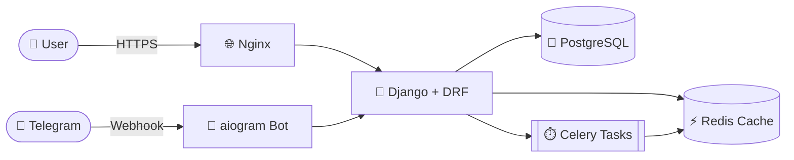
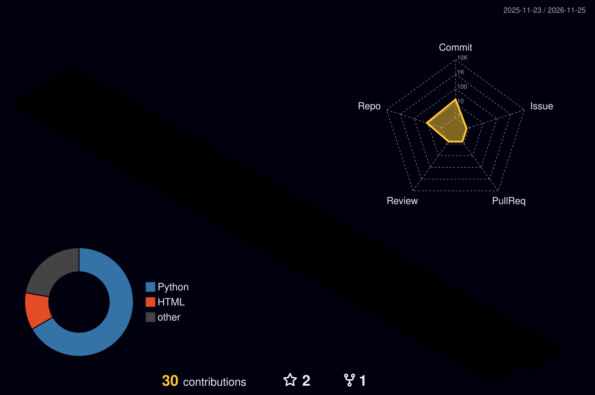

<!-- ===================== HEADER ===================== -->
<div align="center">


<a href="https://git.io/typing-svg">
  
</a>

<br/>


<br/><br/>

<a href="https://youtube.com/@MirkomilCoder"></a>
<a href="https://instagram.com/MirkomilCoder"></a>
<a href="https://linkedin.com/in/MirkomilCoder"></a>
<a href="https://t.me/MirkomilCoder"></a>

</div>


## ⚡ `whoami`

<table>
<tr>
<td width="58%" valign="top">

```python
from dataclasses import dataclass, field

@dataclass
class Developer:
    name: str = "Mirkomil"
    alias: str = "MirkomilCoder"
    location: str = "🇺🇿 Uzbekistan"
    role: str = "Backend Developer"
    core: list = field(default_factory=lambda: [
        "Python (advanced)",
        "Django + DRF (pro)",
        "aiogram 3.x (Telegram bots)",
        "PostgreSQL / SQLite / Redis",
    ])
    currently_learning: list = field(default_factory=lambda: [
        "Docker", "Git & GitHub", "System Design",
    ])
    side_quests: tuple = ("🎮 Gaming", "🖥️ Home server", "🎥 YouTube")

    def motto(self) -> str:
        return "Code. Ship. Learn. Repeat. 🔁"

print(Developer().motto())
```

</td>
<td width="42%" valign="top" align="center">


**🔭 Hozir:** real biznes saytlari (kafe, servis)<br/>
**🤖 Sevimli ish:** murakkab Telegram botlar<br/>
**🖥️ Uyda:** o'z serverim — Linux + Nginx<br/>
**🎥 Kontent:** YouTube'da dasturlash darslari<br/>
**💬 Mendan so'rang:** Django, botlar, DB

</td>
</tr>
</table>


## 🧠 Tech Arsenal

<div align="center">

| Soha | Texnologiyalar |
|:---:|:---|
| **🐍 Til** |  |
| **⚙️ Backend** |  &nbsp;    |
| **🗄️ Database** |  |
| **🎨 Frontend** |  |
| **🚀 DevOps** |  |
| **🧰 Tools** |  |

</div>

### 📶 Mahorat darajasi

```text
Python       ████████████████████░░░░  85%   Advanced
Django/DRF   █████████████████████░░░  90%   Pro
aiogram      ████████████████████░░░░  85%   Advanced
SQL / ORM    ██████████████████░░░░░░  75%   Strong
Linux/Server ███████████████░░░░░░░░░  60%   Intermediate
Docker       ████████░░░░░░░░░░░░░░░░  35%   Learning...
```


## 🏗️ Men qanday backend quraman



<details>
<summary><b>💼 Qanday xizmatlar ko'rsataman? (bosing)</b></summary>
<br/>

| Xizmat | Tavsif |
|---|---|
| 🌐 **Web saytlar** | Django asosida biznes saytlar, admin panel, SEO |
| 🔌 **REST API** | DRF, JWT autentifikatsiya, Swagger hujjatlari |
| 🤖 **Telegram botlar** | aiogram 3, FSM, inline tugmalar, to'lov tizimlari |
| 🗄️ **Database dizayn** | Normalizatsiya, indekslar, tez so'rovlar |
| 🖥️ **Deploy** | Linux server, Nginx, Gunicorn, SSL |

</details>

<details>
<summary><b>⚙️ Mening dev setupim (bosing)</b></summary>
<br/>

```yaml
os:        Linux / Windows
editor:    VS Code + PyCharm
terminal:  bash + git
server:    Home server (Ubuntu + Nginx)
stack:     Django • DRF • aiogram • PostgreSQL • Redis
fuel:      ☕ choy + 🎮 o'yinlar
```

</details>


## 📊 GitHub Analytics

<div align="center">


<br/>


</div>

### 🧊 3D Contribution Calendar
<div align="center">
  
</div>

### 📈 Faollik grafigi


### 🐍 Neon Snake
<div align="center">
<picture>
  <source media="(prefers-color-scheme: dark)" srcset="https://raw.githubusercontent.com/MirkomilCoder/MirkomilCoder/output/snake-neon-dark.svg"/>
  <source media="(prefers-color-scheme: light)" srcset="https://raw.githubusercontent.com/MirkomilCoder/MirkomilCoder/output/snake-neon-light.svg"/>
  
</picture>
</div>


## 🗺️ Roadmap 2026

```diff
+ [✓] Python — advanced
+ [✓] Django + DRF — pro daraja
+ [✓] aiogram — Telegram botlar
+ [✓] Real mijozlar uchun saytlar
! [~] Git & GitHub — chuqur o'rganish
! [~] Docker & CI/CD
- [ ] System Design asoslari
- [ ] Junior Backend Developer bo'lib ishga kirish 🎯
```

## 💭 Kun iqtibosi

<div align="center">
  
</div>


<div align="center">

### 🤝 Birga ishlaymizmi?

**Sayt, API yoki Telegram bot kerakmi?** Yozing — tez javob beraman ⚡

<a href="https://t.me/MirkomilCoder"></a>
<a href="https://youtube.com/@MirkomilCoder"></a>

<br/><br/>

<i>⭐ Profilim yoqqan bo'lsa, repolarimga star bosishni unutmang!</i>


</div>
